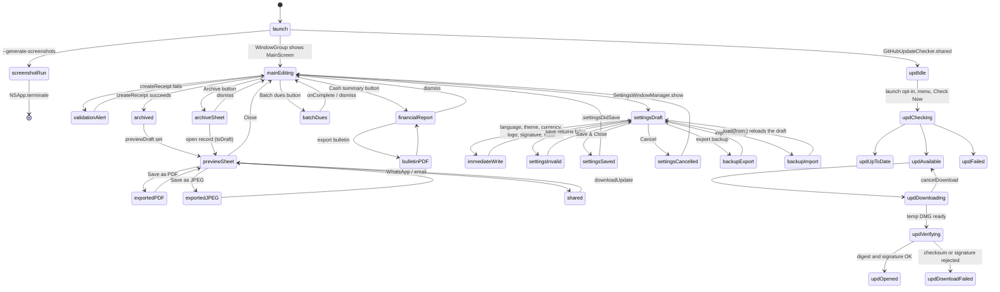

# AptReceipt Symbolic Memory Graph

- **Last updated:** 2026-10-20
- **Scope:** AptReceipt (aptreceipt)
- **Purpose:** Runtime states and transitions. Use a `node_id` to find the code symbol that owns that state.

| node_id | Meaning | Owning symbol |
| --- | --- | --- |
| `launch` | App start | `AptReceiptApp`, `AppDelegate.applicationDidFinishLaunching` |
| `screenshotRun` | Screenshot mode; shared settings and archive in memory only | `ScreenshotMode`, `AppDelegate.generateScreenshots` |
| `mainEditing` | Editing the receipt form | `MainScreen`, `MainScreenViewModel` |
| `validationAlert` | Invalid form | `MainScreenViewModel.validationError` |
| `archived` | Draft built and stored | `MainScreenViewModel.createReceipt`, `ReceiptArchiveStore.add` |
| `previewSheet` | A4 preview | `MainScreenViewModel.previewDraft`, `ReceiptPreviewSheet`, `ReceiptDocumentView` |
| `exportedPDF` / `exportedJPEG` | File written | `ReceiptPreviewSheet.saveReceiptPDF` / `saveReceiptImage` |
| `shared` | WhatsApp or mail opened | `WhatsAppShareHelper.shareURL` / `emailURL` |
| `archiveSheet` | Archive list | `ReceiptArchiveSheet` (`isPresentingArchive`) |
| `financialReport` / `bulletinPDF` | Cash summary, bulletin export | `ApartmentFinancialReportSheet`, `ApartmentBulletinBoardView` |
| `batchDues` | Batch dues generation | `BatchDuesGeneratorSheet.executeBatchGeneration` |
| `settingsDraft` | Settings window open with a draft | `SettingsWindowManager`, `SettingsTabViewController.draft`, `SettingsView` |
| `immediateWrite` | Change saved outside the draft | `SettingsViewModel.selectLanguage` / `resetPreferences`, `SettingsView.themeSelection` / `currencySelection`, `ReceiptSettingsStore.importLogo` / `importSignature` |
| `settingsInvalid` | Validation alert | `SettingsViewModel.validationError` |
| `settingsSaved` / `settingsCancelled` | Committed or discarded | `SettingsViewModel.save(to:)` / `SettingsView.close()` |
| `backupExport` / `backupImport` | JSON backup | `ReceiptSettingsStore.exportSystemBackup` / `importSystemBackup` |
| `updIdle` ... `updFailed` | Check status | `UpdateCheckStatus` (`idle`, `checking`, `upToDate`, `updateAvailable`, `failed`), `UpdateCheckFailure` |
| `updDownloading` | DMG download | `GitHubUpdateChecker.downloadUpdate`, `UpdateFileDownloader`, `UpdateDownloadWindowManager` |
| `updVerifying` | SHA-256 and Ed25519 checks | `UpdateChecksums.sha256`, `UpdateSignature.isValid` |
| `updOpened` / `updDownloadFailed` | Result alert | `moveToDownloads`, `presentDownloadCompletedAlert` / `presentDownloadFailedAlert` |
