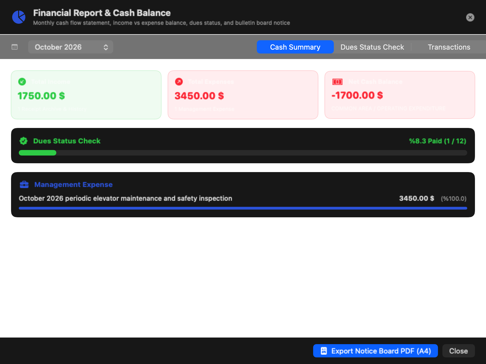
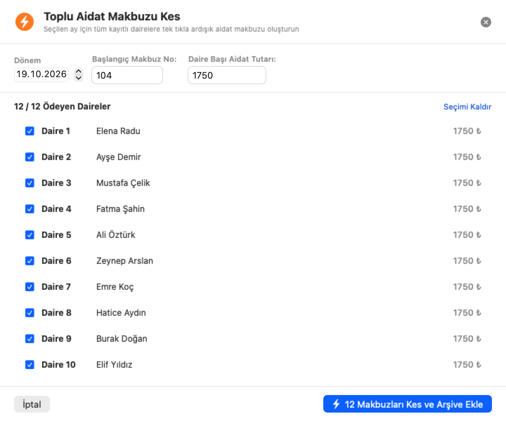
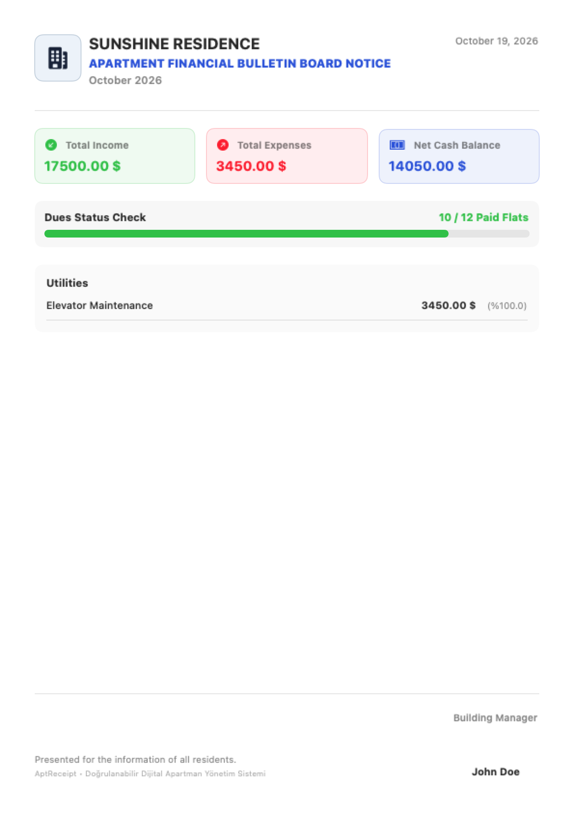
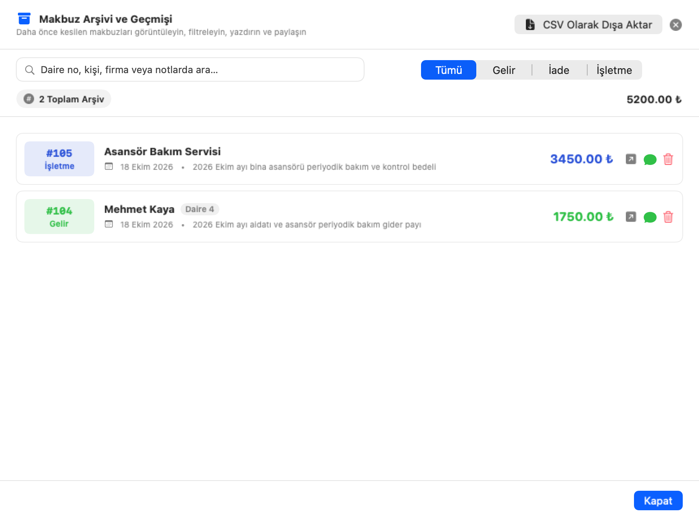

# Apartment Receipt Generator for macOS

A modern, native macOS application to effortlessly generate, manage, and export official apartment income and expense receipts.

## Features

- **Official A4 Invoice Format:** Styled to official ISO A4 itemized invoice standards with dual issuer/payer cards, service breakdown table, statutory tax exemption clause, and amounts in words.
- **Vector PDF & JPEG Export:** Export crystal-clear vector PDF documents with selectable text or high-resolution JPEG images.
- **Locale-Aware Smart Filenames:** Automatically generates descriptive filenames containing apartment name, document type, flat number, resident, and billing period formatted in the user's selected language.
- **Trilingual Support (English, Turkish, Romanian):** 1-to-1 localization for English (default), Turkish, and Romanian, automatically resolving to system locale or user choice.
- **Interactive License Viewer:** Direct read-only inspection of the GNU General Public License v3.0 from Preferences and About windows, highlighting publisher **Babadogan Tech and Edu**.
- **Real-Time Live Receipt Preview:** Live interactive preview card dynamically updates as you type.
- **Automatic Theme Support:** Light, Dark, and Automatic System appearance modes.
- **Dedicated Settings Window:** Accessible from the macOS Menu Bar (`Cmd+,` / `Preferences`) or the compact gear icon on the main screen, with tabbed sections for Building Details, Residents Directory, Appearance & Language, Signature, and About.
- **Residents Directory:** Save flat numbers and resident names for one-click auto-fill.
- **Digital Signature:** Import authorized signature images (PNG/JPEG) to print directly onto exported receipts.
- **Auto-Incrementing Sequence Numbers:** Receipt numbers increment automatically after generation.
- **Financial Report & Cash Register Balance (Kasa Özeti):** Monthly income-expense balance sheet, net cash balance KPIs, expense breakdown by category with proportional progress meters, and transaction ledger.
- **Dues Tracking Checklist & WhatsApp Reminders:** Interactive resident payment ledger showing who paid and who is pending for any period, with 1-click WhatsApp payment reminders.
- **A4 Printable Apartment Bulletin Board Notice (Pano İlanı):** Generates and exports official A4 PDF notice sheets ready to hang on building bulletin boards or share on resident groups.
- **Batch Dues Generator (Toplu Aidat Makbuzu):** 1-click generation of sequential receipts for all or selected apartment flats in a single operation.
- **Apple Vision & PDFKit Invoice OCR Import:** Smart OCR text and amount recognition from scanned vendor invoices or PDFs, with automated page-2 attachment merging into exported receipt PDFs.

---

## UI Screenshots

<table>
<tr>
  <td align="center"><b>Main Dashboard (Turkish)</b></td>
  <td align="center"><b>Main Dashboard (English)</b></td>
</tr>
<tr>
  <td></td>
  <td></td>
</tr>
<tr>
  <td align="center"><b>Apartment Financial Report & Cash Balance</b></td>
  <td align="center"><b>Batch Dues Receipt Generator</b></td>
</tr>
<tr>
  <td></td>
  <td></td>
</tr>
<tr>
  <td align="center"><b>Printable A4 Bulletin Board Notice (Pano İlanı)</b></td>
  <td align="center"><b>Receipt Archive & History</b></td>
</tr>
<tr>
  <td></td>
  <td></td>
</tr>
<tr>
  <td align="center"><b>Preferences Window (Settings & License)</b></td>
  <td align="center"><b>A4 Income Receipt Certificate (PDF / JPEG)</b></td>
</tr>
<tr>
  <td></td>
  <td></td>
</tr>
<tr>
  <td align="center" colspan="2"><b>A4 Expense Receipt Certificate (PDF / JPEG)</b></td>
</tr>
<tr>
  <td align="center" colspan="2"></td>
</tr>
</table>

---

## Requirements

- macOS 13.0 (Ventura) or later
- Apple Silicon or Intel Mac

---

## License

This project is licensed under the **GNU General Public License v3.0 (GPL-3.0)** - see the [LICENSE](LICENSE) file for details.

Publisher: **Babadogan Tech and Edu**
