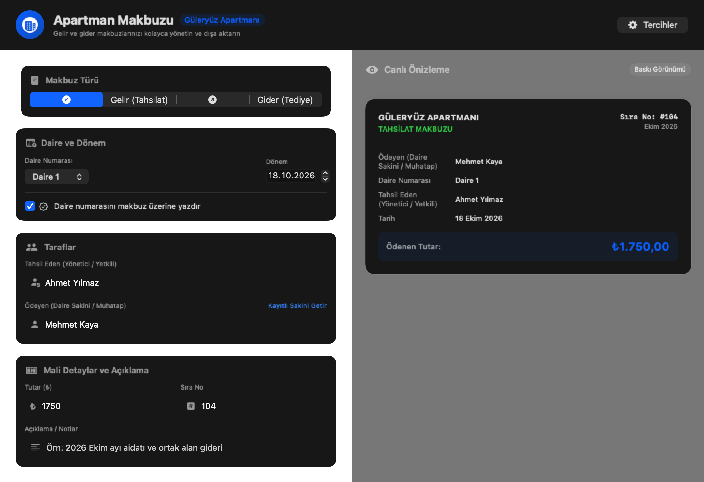
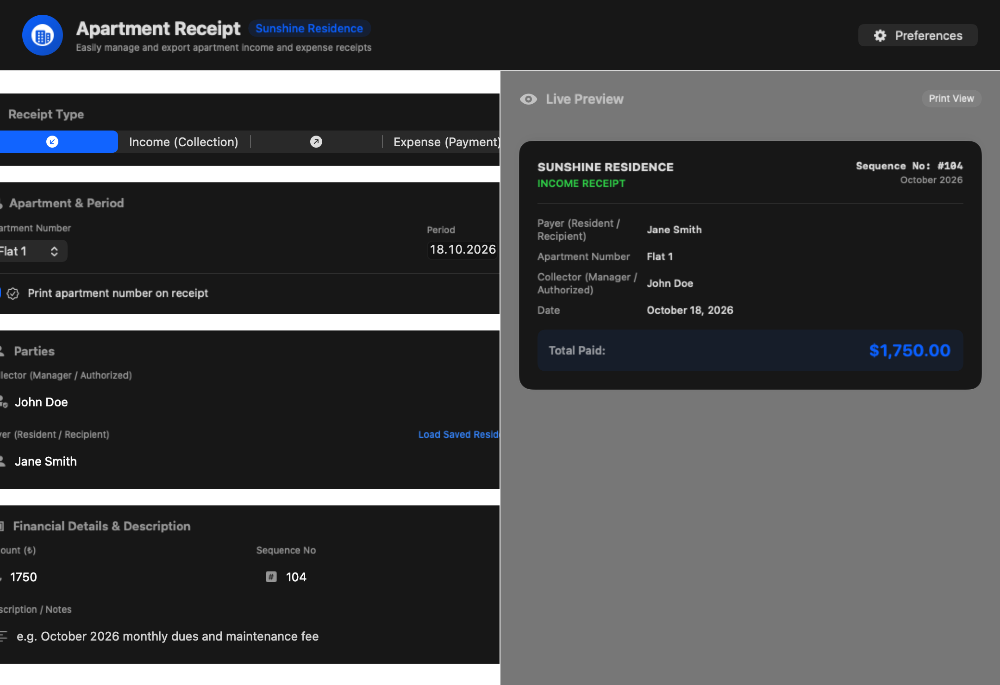
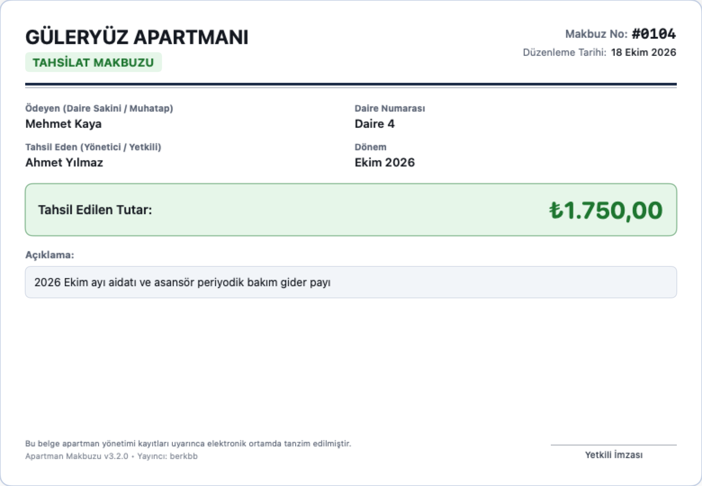
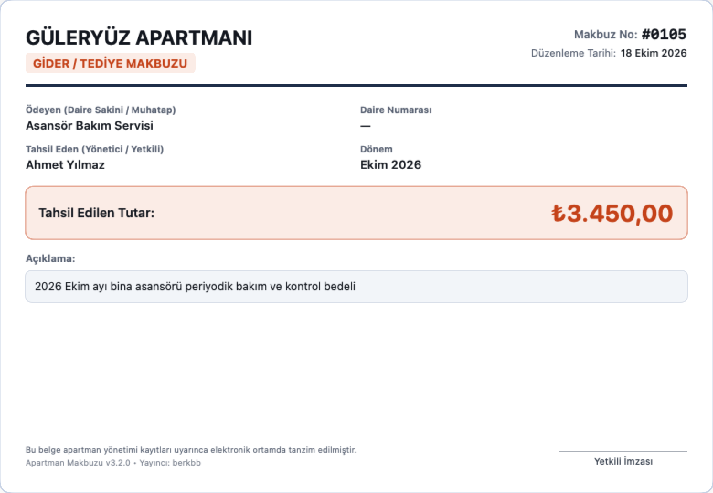
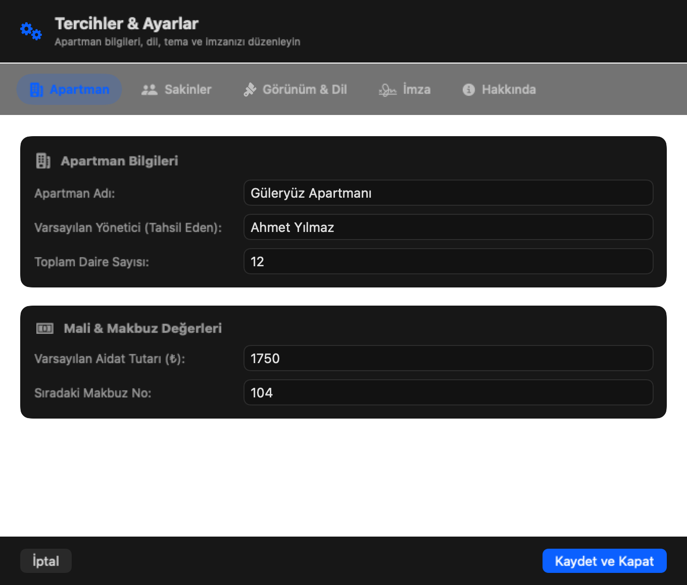

# Apartment Receipt Generator for macOS

A modern, native macOS application to effortlessly generate, manage, and export official apartment income and expense receipts.

## Features

- **Income & Expense Receipts:** Generate official collection (income) and disbursement (expense) receipts.
- **Real-Time Live Receipt Preview:** Live interactive preview card dynamically updates as you type.
- **Multilingual Support (1-to-1):** Full support for English and Turkish with instant language switching in Settings.
- **Automatic Theme Support:** Light, Dark, and Automatic System appearance modes.
- **Dedicated Settings Window:** Accessible from the macOS Menu Bar (`Cmd+,` / `Preferences`) with tabbed sections for Building Details, Residents Directory, Appearance & Language, Signature, and About.
- **Residents Directory:** Save flat numbers and resident names for one-click auto-fill.
- **Digital Signature:** Import authorized signature images (PNG/JPEG) to print directly onto exported receipts.
- **High-Resolution Export:** Export receipts as crystal-clear JPEG image files.
- **Auto-Incrementing Sequence Numbers:** Receipt numbers increment automatically after generation.

---

## UI Screenshots

<table>
<tr>
  <td align="center"><b>Main Dashboard (Turkish)</b></td>
  <td align="center"><b>Main Dashboard (English)</b></td>
</tr>
<tr>
  <td></td>
  <td></td>
</tr>
<tr>
  <td align="center"><b>Income Receipt Certificate</b></td>
  <td align="center"><b>Expense Receipt Certificate</b></td>
</tr>
<tr>
  <td></td>
  <td></td>
</tr>
<tr>
  <td colspan="2" align="center"><b>Preferences & Settings Window</b></td>
</tr>
<tr>
  <td colspan="2" align="center"></td>
</tr>
</table>

---

## Requirements

- macOS 13.0 (Ventura) or later
- Apple Silicon or Intel Mac

---

## License

This project is licensed under the **GNU General Public License v3.0 (GPL-3.0)** - see the [LICENSE](LICENSE) file for details.

Publisher: **berkbb**
